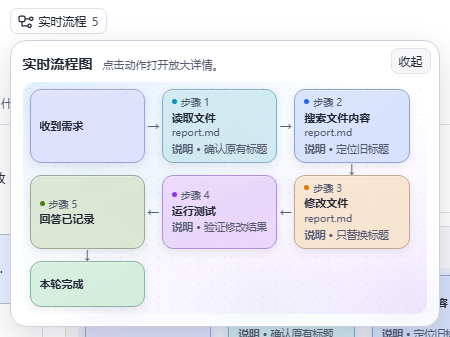

# AI 思路透视镜 · AI Step Lens

DeepSeek Harness 的会话流程插件。按轮次查看 AI 做了什么、用了哪些工具、当前做到哪一步，以及每个动作对应的说明和结果。



## 安装

在 DeepSeek Harness 的 **插件** 页点击 **添加插件**，输入下面的地址并安装。

```text
github:stayhear0722-dev/deepseek-harness-step-lens#main
```

安装完成后，打开一个有对话记录的会话。会话标题旁的 **实时流程** 显示最新一轮，**AI 思路** 标签可切换和回看各轮流程。点击节点可查看放大详情。

已在 DeepSeek Harness `0.2.1-rc.5` 的 Windows 桌面环境验证界面，并在同版本的独立 Web 配置中验证 Git 源码包安装。仓库包含构建好的前端模块，基本流程视图可直接使用。

### 命令行安装

已有 `dsh` 命令时，先打开一次桌面应用初始化配置，再从托盘完整退出应用。运行安装命令后重新打开桌面应用。

```powershell
dsh plugin --profile desktop add "github:stayhear0722-dev/deepseek-harness-step-lens#main"
```

使用 Harness Web 时，将 `--profile desktop` 换成 `--profile web`。也可在插件页直接粘贴 GitHub 地址。 [DeepSeek Harness CLI 文档](https://github.com/deepseek-ai/deepseek-harness/blob/master/apps/cli/reference/README.md)

### 从源码压缩包安装

如果暂时无法访问 GitHub，可以解压源码包，保留解压目录。先从托盘完整退出 Harness，在 PowerShell 中进入包含 `package.json` 的插件根目录，然后执行下面的命令。安装完成后重新打开 Harness。

```powershell
dsh plugin --profile desktop add 'link:.'
```

使用 Web 配置时，将 `--profile desktop` 换成 `--profile web`。链接安装直接使用解压后的目录。

## 功能

- **实时流程小面板。** 新一轮开始时自动展开，跟随当前动作。收起后可从会话标题旁重新打开。
- **按轮回看。** 流程图在上，具体动作在下。读取、搜索、修改、执行等操作用不同底色表示，当前节点和失败状态有独立标记。
- **节点详情。** 点击节点可放大查看工具说明、相关思考、参数、执行结果和子动作。
- **可选中文翻译。** 将关联的英文思考短句在本机翻译。流程根据 Harness 的会话记录绘制，说明会标注来源。

## 可选离线翻译

准备 **Windows x64、Python 3.13 x64** 和当前的 **Microsoft Visual C++ v14 x64 Redistributable**。安装脚本会下载经过哈希校验的 Python 依赖与英中模型，然后运行一次本地翻译检查。 [Microsoft 运行库下载](https://learn.microsoft.com/en-us/cpp/windows/latest-supported-vc-redist/)

在 PowerShell 中对已经安装的插件执行以下命令。Web 配置将路径中的 `desktop` 换成 `web`。

```powershell
$dshDir = if ($env:DSH_HOME) { $env:DSH_HOME } else { Join-Path $env:USERPROFILE '.dsh' }
$stepLensDir = Join-Path $dshDir 'profiles/desktop/node_modules/@local/step-lens'
py -3.13 (Join-Path $stepLensDir 'scripts/setup-translation.py')
```

从源码开发时，也可以在插件根目录运行 `py -3.13 scripts/setup-translation.py`。安装成功后刷新 Harness。模型和依赖留在插件目录的 `translation-runtime/`，翻译通过本机 Harness 服务完成。

模型使用 [Argos Translate en→zh 1.9](https://github.com/argosopentech/argospm-index)，基于 Jörg Tiedemann 和 Santhosh Thottingal 的 [OPUS-MT](https://aclanthology.org/2020.eamt-1.61/)。原模型按 [CC BY 4.0](https://creativecommons.org/licenses/by/4.0/) 提供，安装脚本保留模型包中的署名和许可说明。

## 从源码开发

```powershell
git clone https://github.com/stayhear0722-dev/deepseek-harness-step-lens.git
cd deepseek-harness-step-lens
node build.mjs
node --test
```

修改 `src/` 后运行 `node build.mjs` 生成 `client.js`。离线翻译集成测试在安装翻译运行时后运行。

## 许可

插件源码采用 [MIT 许可证](LICENSE)。另行下载的模型和第三方依赖采用各自的许可证。
